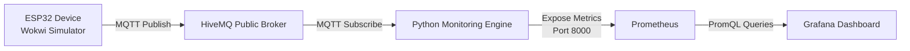
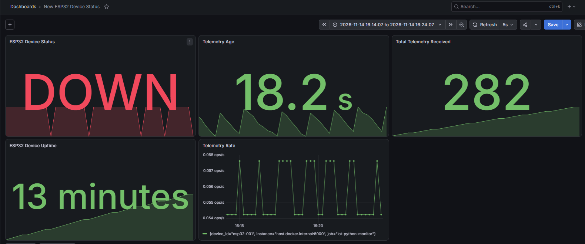
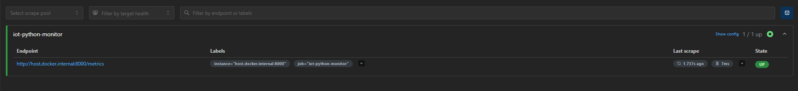
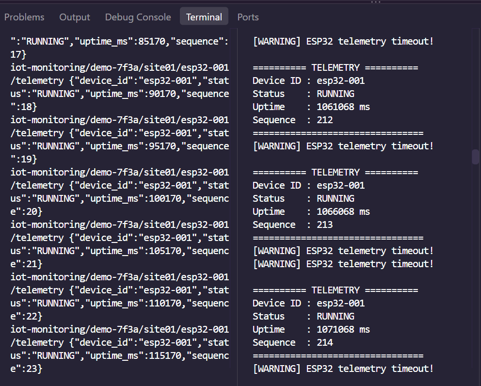

# Industrial IoT Monitoring Platform

An Industrial IoT monitoring project that collects ESP32 telemetry through MQTT, processes device data using Python, exposes metrics to Prometheus, and visualizes monitoring information through Grafana.

This project demonstrates an end-to-end IoT monitoring pipeline using open-source technologies.

## 1. Project Overview

The platform monitors telemetry published by an ESP32 device simulated in Wokwi.

Device telemetry is transmitted through a public MQTT broker, processed by a Python monitoring engine, collected by Prometheus, and displayed in a Grafana dashboard.

The current implementation focuses on device availability, telemetry reception, uptime, sequence tracking, and telemetry freshness.

## 2. System Architecture



### Data Flow

1. ESP32 publishes JSON telemetry every 5 seconds.
2. HiveMQ receives the telemetry through MQTT.
3. Python subscribes to the MQTT topic and processes incoming messages.
4. Python exposes monitoring metrics through an HTTP endpoint.
5. Prometheus scrapes the metrics every 5 seconds.
6. Grafana queries Prometheus and displays the monitoring dashboard.

## 3. Technology Stack

| Component | Technology |
|---|---|
| IoT Device Simulation | ESP32 / Wokwi |
| Communication Protocol | MQTT |
| MQTT Broker | HiveMQ Public Broker |
| Monitoring Engine | Python |
| Metrics Collection | Prometheus |
| Visualization | Grafana |
| Container Platform | Docker |
| Monitoring Query Language | PromQL |

## 4. Project Structure

```text
iot-network-monitoring/
├── docs/
│   └── screenshots/
│       ├── grafana-dashboard.png
│       ├── prometheus-targets.png
│       └── python-telemetry.png
├── firmware/
├── grafana/
├── monitoring/
│   └── mqtt_subscriber.py
├── mqtt/
├── prometheus/
│   └── prometheus.yml
├── scripts/
├── tests/
├── .gitignore
├── README.md
└── docker-compose.yml
```

## 5. Monitoring Metrics

The Python monitoring engine exposes the following Prometheus metrics:

| Metric | Description |
|---|---|
| `iot_messages_received_total` | Total MQTT telemetry messages received |
| `iot_device_up` | Device telemetry availability status |
| `iot_device_uptime_ms` | Device uptime in milliseconds |
| `iot_last_sequence` | Latest telemetry sequence number |
| `iot_last_message_timestamp_seconds` | Timestamp of the latest received message |
| `iot_telemetry_age_seconds` | Age of the latest telemetry message |

Device availability is determined by telemetry freshness. If no telemetry is received within the configured 15-second timeout, the device status is marked as unavailable.

## 6. Grafana Dashboard

The Grafana dashboard provides visibility into the ESP32 monitoring metrics.



*Grafana dashboard showing device status, telemetry age, received messages, uptime, and telemetry rate.*

## 7. Prometheus Monitoring

Prometheus collects metrics exposed by the Python monitoring engine.



*Prometheus target status showing the Python monitoring endpoint.*

## 8. Python Monitoring Engine

The Python application subscribes to the MQTT telemetry topic, processes incoming JSON messages, and exposes metrics for Prometheus.



*Python terminal output showing received ESP32 telemetry messages.*

## 9. Running the Project

### Prerequisites

- Python 3
- Docker Desktop
- Wokwi ESP32 simulation
- Git

### Start Docker Services

```powershell
docker compose up -d
```

### Install Python Dependencies

```powershell
python -m pip install paho-mqtt prometheus-client
```

### Start the Monitoring Engine

```powershell
python monitoring\mqtt_subscriber.py
```

### Access Monitoring Services

| Service | URL |
|---|---|
| Python Metrics | http://localhost:8000/metrics |
| Prometheus | http://localhost:9090 |
| Prometheus Targets | http://localhost:9090/targets |
| Grafana | http://localhost:3000 |

The Grafana Prometheus data source should use:

```text
http://prometheus:9090
```

## 10. Current Implementation Scope

The current project demonstrates:

- ESP32 telemetry simulation using Wokwi.
- MQTT communication through HiveMQ.
- Python-based telemetry processing.
- Prometheus metrics exposure and collection.
- Grafana dashboard visualization.
- Device availability monitoring based on telemetry timeout.

## 11. Limitations and Security Considerations

- The project currently uses one simulated ESP32 device.
- HiveMQ public broker uses unencrypted MQTT communication on port 1883.
- The public broker is intended for demonstration and testing, not sensitive or production telemetry.
- Device availability is inferred from telemetry reception and does not independently verify physical device health.
- Network diagnostics such as ICMP reachability, packet loss, latency, and jitter are not yet implemented.
- Production authentication, TLS encryption, alerting, and multi-device deployment are future improvements.

## 12. Future Improvements

- Support multiple ESP32 devices.
- Implement network connectivity diagnostics.
- Add packet loss and latency monitoring.
- Configure Grafana alerting.
- Implement secure MQTT communication using authentication and TLS.
- Extend the platform for multi-site industrial monitoring.

## 13. Project Objective

The objective of this project is to demonstrate practical integration of IoT communication, Python-based monitoring, time-series metrics collection, and real-time visualization as a foundation for an Industrial IoT Monitoring Platform.